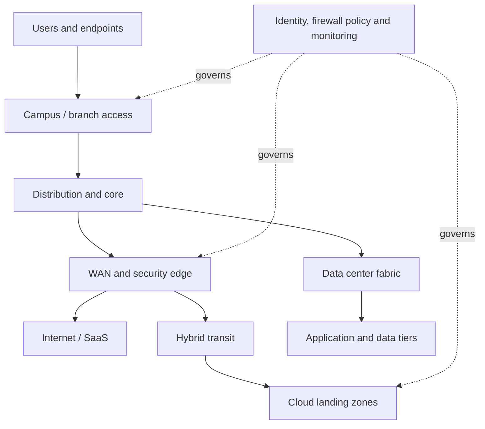
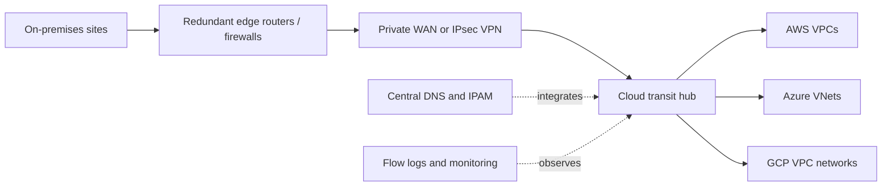
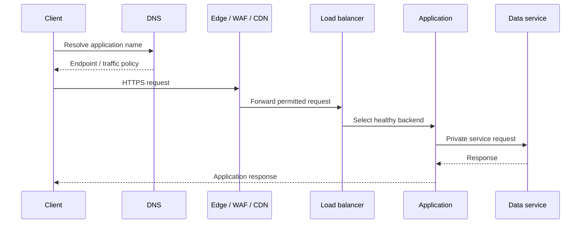
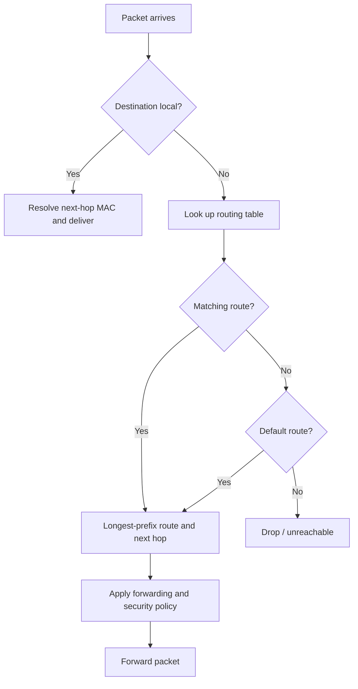

# Visual Diagrams Library

Mermaid sources are version-controlled and editable. Use draw.io for detailed physical and logical network layouts.

## Enterprise network overview

## Hybrid cloud connectivity

## Application delivery

## Routing decision

Sources: [architecture.mmd](architecture.mmd), [architecture.drawio](architecture.drawio), [architecture.svg](architecture.svg). Record assumptions, address ranges and security boundaries on every project diagram.
