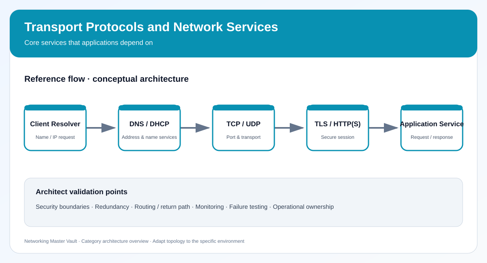

# 06. Transport Protocols and Network Services

> Category tracker · 10 topics · Networking Master Vault

[← Back to master dashboard](../../README.md) · [Open reference architecture](../../NETWORK-REFERENCE-ARCHITECTURE.md)

## Category architecture diagram

- [Open editable draw.io source](diagrams/category-architecture.drawio)
- [View SVG preview](diagrams/category-architecture.svg)

Use the editable diagram as the category-level reference. Extend it with environment-specific addressing, trust boundaries, routing, redundancy and operational ownership when building a real design.

## Learning checklist

- [ ] [TCP](../../services/tcp.md) — Reliable, ordered, connection-oriented transport with flow and congestion control.
- [ ] [UDP](../../services/udp.md) — Connectionless transport with low overhead for latency-sensitive and query-response traffic.
- [ ] [ICMP and ICMPv6](../../services/icmp.md) — Network control and error reporting used by diagnostics and path MTU discovery.
- [ ] [Ping and Traceroute](../../services/ping-traceroute.md) — Test reachability, round-trip time and the path packets take.
- [ ] [DHCP](../../services/dhcp.md) — Automatically lease IP configuration to clients using discover, offer, request and acknowledge.
- [ ] [DNS](../../services/dns.md) — Resolve names to records and support service discovery and traffic steering.
- [ ] [HTTP and HTTPS](../../services/http-https.md) — Application-layer web request/response and encrypted transport patterns.
- [ ] [TLS, Certificates and PKI](../../services/tls-certificates.md) — Authenticate endpoints and protect data in transit using cryptographic sessions.
- [ ] [TCP and UDP Ports](../../services/ports-protocols.md) — Identify application endpoints and common service port assignments.
- [ ] [NTP, SNMP, Syslog and SSH](../../services/ntp-snmp-syslog-ssh.md) — Core time, telemetry, event logging and secure administration services.

## Completion standard

A topic is complete when you can explain its purpose and trade-offs, draw its traffic flow, configure or inspect it in a safe lab, validate expected behavior, troubleshoot one failure, and explain where it fits in an enterprise design.

## Suggested lab evidence

Record objective, topology, addressing, configuration, expected result, observed result, failure injection, troubleshooting steps, screenshots or sanitized command output, cleanup and lessons learned.
