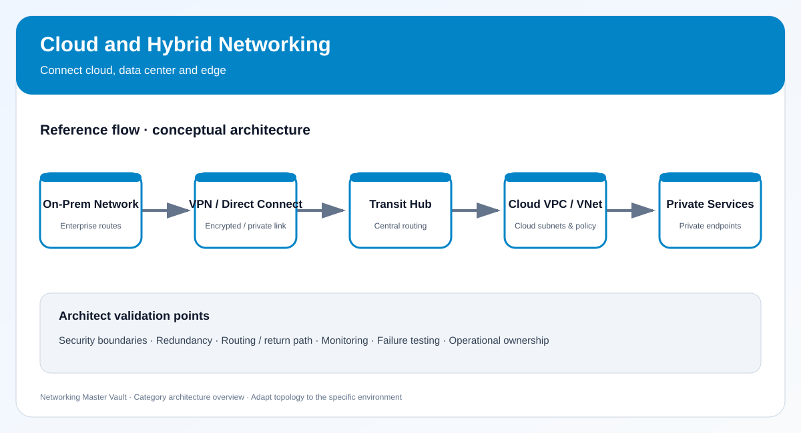

# 08. Cloud and Hybrid Networking

> Category tracker · 10 topics · Networking Master Vault

[← Back to master dashboard](../../README.md) · [Open reference architecture](../../NETWORK-REFERENCE-ARCHITECTURE.md)

## Category architecture diagram

- [Open editable draw.io source](diagrams/category-architecture.drawio)
- [View SVG preview](diagrams/category-architecture.svg)

Use the editable diagram as the category-level reference. Extend it with environment-specific addressing, trust boundaries, routing, redundancy and operational ownership when building a real design.

## Learning checklist

- [ ] [Cloud Networking Fundamentals](../../services/cloud-networking-fundamentals.md) — Map virtual networks, software-defined networking and shared responsibility concepts.
- [ ] [AWS VPC](../../services/aws-vpc.md) — AWS virtual networking including subnets, route tables, gateways and endpoints.
- [ ] [Azure Virtual Network](../../services/azure-vnet.md) — Azure private network boundary, subnets, peering, routing and connectivity.
- [ ] [Google Cloud VPC](../../services/gcp-vpc.md) — Global VPC networks, regional subnets, routes and firewall policies.
- [ ] [Cloud Subnets and Route Tables](../../services/cloud-subnets-routes.md) — Plan address ranges and control next-hop selection in cloud networks.
- [ ] [Internet and NAT Gateways](../../services/cloud-nat-gateways.md) — Provide controlled ingress/egress paths and outbound address translation.
- [ ] [VPC/VNet Peering](../../services/vpc-peering.md) — Connect virtual networks privately and understand non-transitive routing.
- [ ] [Transit Gateways and Virtual WAN](../../services/transit-hubs.md) — Build hub-and-spoke connectivity and centralized network transit.
- [ ] [Private Endpoints and Private Service Connectivity](../../services/cloud-private-connectivity.md) — Reach platform services privately without exposing traffic to public internet.
- [ ] [Hybrid VPN and Dedicated Connectivity](../../services/hybrid-dedicated-connectivity.md) — Design site-to-cloud links using VPN, Direct Connect, ExpressRoute and Interconnect.

## Completion standard

A topic is complete when you can explain its purpose and trade-offs, draw its traffic flow, configure or inspect it in a safe lab, validate expected behavior, troubleshoot one failure, and explain where it fits in an enterprise design.

## Suggested lab evidence

Record objective, topology, addressing, configuration, expected result, observed result, failure injection, troubleshooting steps, screenshots or sanitized command output, cleanup and lessons learned.
