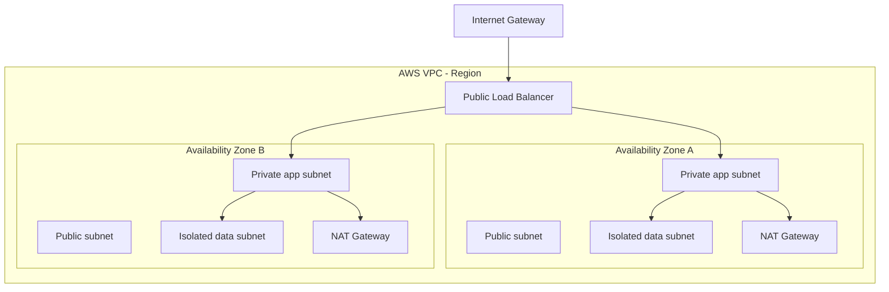

# AWS VPC

> **Networking Master Vault · Cloud and Hybrid Networking · NET-08-aws-vpc**

[← Category tracker](../buckets/08-cloud-hybrid/README.md) · [← Master dashboard](../README.md)

## 1. Fundamentals and purpose

Amazon Virtual Private Cloud (VPC) is a logically isolated virtual network in AWS. A VPC is regional and contains subnets, route tables, network interfaces, security controls and connectivity attachments. Subnets are associated with Availability Zones. AWS manages the underlying physical network; customers design IP ranges, routes, security and connectivity.

Core components:
- **CIDR:** IPv4 and optionally IPv6 address ranges assigned to the VPC.
- **Subnet:** AZ-scoped IP range; classify by routing and workload role, not merely by name.
- **Route table:** destination-to-target entries that determine next-hop behavior.
- **Internet Gateway (IGW):** enables internet connectivity for eligible resources with public addressing and routes.
- **NAT Gateway:** provides outbound IPv4 internet access for private subnet resources; it does not provide unsolicited inbound connectivity.
- **Security Group:** stateful, ENI-associated virtual firewall.
- **Network ACL:** stateless subnet-level filter.
- **VPC Endpoint:** private access to supported AWS services; gateway and interface endpoint behavior differs.
- **Transit Gateway / peering / VPN / Direct Connect:** connectivity patterns between networks and on-premises.

## 2. Reference architecture

A production baseline often uses at least two Availability Zones:
- Public subnets for internet-facing load balancers and NAT Gateways where required.
- Private application subnets for compute workloads.
- Isolated data subnets for databases with no direct internet route.
- Separate route tables and security groups by tier.
- Centralized egress inspection or transit where security and scale require it.
- VPC Flow Logs and reachability analysis for operations.



This is a logical pattern; exact route targets, endpoint choices and NAT placement depend on application requirements, cost and resilience objectives.

## 3. Traffic-flow example

A private EC2 instance downloads a package:
1. Instance sends packet to its subnet's VPC router.
2. Subnet route table matches `0.0.0.0/0` to a NAT Gateway.
3. NAT Gateway resides in a public subnet whose route table sends internet traffic to an IGW.
4. IGW provides internet connectivity; return traffic is translated and routed back.
5. Security Group state and NACL rules must allow the relevant request/response path.

A NAT Gateway does not replace an IGW; its public-subnet route path requires an IGW. For private AWS service access, consider VPC endpoints rather than sending traffic through public egress.

## 4. AWS CLI commands

Use a sandbox account and least-privilege credentials. These are read-oriented inspection commands:

```bash
aws ec2 describe-vpcs
aws ec2 describe-subnets --filters Name=vpc-id,Values=vpc-xxxxxxxx
aws ec2 describe-route-tables --filters Name=vpc-id,Values=vpc-xxxxxxxx
aws ec2 describe-internet-gateways
aws ec2 describe-nat-gateways
aws ec2 describe-security-groups
aws ec2 describe-network-acls
aws ec2 describe-vpc-endpoints
```

Inspect an instance's network interfaces and security groups:
```bash
aws ec2 describe-instances --instance-ids i-xxxxxxxx
aws ec2 describe-network-interfaces --filters Name=attachment.instance-id,Values=i-xxxxxxxx
```

Expected: resources show VPC association, subnet/AZ, route destinations and targets, SG ingress/egress rules, and NACL numbered entries. Replace placeholders with IDs from your sandbox.

## 5. Linux instance commands

```bash
ip -br addr
ip route
ip route get 1.1.1.1
ss -tulpn
curl -I https://example.com
traceroute 1.1.1.1
```

Correlate guest OS output with VPC route tables, SGs, NACLs, DNS and NAT/IGW paths. A guest route table alone does not reveal all VPC routing decisions.

## 6. Practical lab: public and private subnet design

1. Create a sandbox VPC with a non-overlapping RFC1918 CIDR.
2. Create public and private subnets in two AZs.
3. Attach an IGW and associate a public route table with public subnets.
4. Create NAT Gateway(s) only if required; understand per-AZ cost and availability trade-offs.
5. Associate private route tables with private subnets and route default internet egress through NAT.
6. Launch a test instance in a private subnet with no public IP.
7. Test required outbound access and verify inbound internet initiation is not possible.
8. Add VPC Flow Logs and inspect traffic.
9. Delete billable resources in dependency order after validation.

**Expected result:** public resources with public addressing and correct routes can receive intended internet traffic; private instances can initiate permitted outbound connections through NAT; unsolicited internet inbound connections to private instances are not enabled by NAT.

## 7. AWS vs Azure vs GCP

| Capability | AWS | Azure | Google Cloud |
|---|---|---|---|
| Virtual network | VPC (regional) | VNet (regional) | VPC (global, subnet ranges regional) |
| Subnet scope | Availability Zone | Region | Region |
| Route control | Route tables | UDRs / system routes | VPC routes |
| Stateful workload policy | Security Groups | NSGs | VPC firewall rules |
| Stateless subnet policy | Network ACLs | NSGs are stateful; use supported NVA for stateless filtering | VPC firewall rules are stateful |
| Internet/NAT | IGW, NAT Gateway | Internet egress, NAT Gateway | External IP, Cloud NAT |
| Hub transit | Transit Gateway | Virtual WAN / hub VNet | Network Connectivity Center |
| Private service access | Gateway/interface endpoints | Private Link | Private Service Connect |

## 8. Troubleshooting scenarios

- **Instance has no internet:** check subnet association, default route, IGW/NAT path, public IP where needed, SG, NACL and DNS.
- **Public subnet instance unreachable:** verify public IPv4/EIP, IGW route, SG inbound, NACL return ephemeral ports and OS firewall.
- **Private instance cannot reach AWS service:** verify endpoint type, endpoint policy, private DNS, SG/NACL and route.
- **VPC peering traffic fails:** check non-overlapping CIDRs, both route tables, SG/NACL and peering DNS options as relevant.
- **Hybrid route missing:** inspect VPN/DX BGP, Transit Gateway route tables, propagation and route filters.
- **Cross-AZ NAT dependency:** consider AZ failure and data processing charges; align NAT strategy with availability requirements.

## 9. Interview and architecture questions

1. Explain the difference between a public and private subnet.
2. Why does a private subnet use a NAT Gateway and what does NAT not do?
3. Compare Security Groups and Network ACLs.
4. When would you use VPC peering vs Transit Gateway?
5. Design a multi-AZ three-tier VPC with centralized inspection and hybrid connectivity.

## 10. Knowledge validation

- [ ] Explain VPC, subnet, route table, IGW, NAT, SG, NACL and endpoints.
- [ ] Trace public and private instance egress.
- [ ] Inspect a VPC using AWS CLI.
- [ ] Diagnose a deliberately incorrect route or security rule.
- [ ] Produce a two-AZ design with cost, availability and security trade-offs.

## Further reading

[AWS VPC User Guide](https://docs.aws.amazon.com/vpc/latest/userguide/what-is-amazon-vpc.html) · [VPC route tables](https://docs.aws.amazon.com/vpc/latest/userguide/VPC_Route_Tables.html) · [Security Groups](https://docs.aws.amazon.com/vpc/latest/userguide/vpc-security-groups.html) · [NAT Gateway](https://docs.aws.amazon.com/vpc/latest/userguide/vpc-nat-gateway.html)
