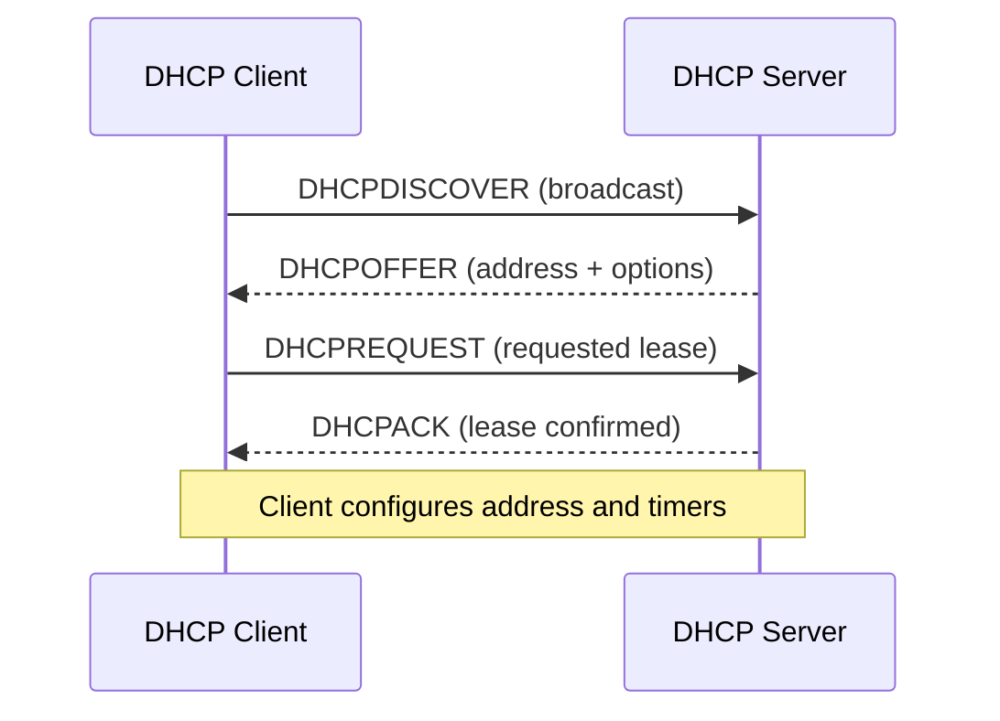

# DHCP

> **Networking Master Vault · Transport Protocols and Network Services · NET-06-dhcp**

[← Category tracker](../buckets/06-protocols-services/README.md) · [← Master dashboard](../README.md)

## 1. Fundamentals and purpose

Dynamic Host Configuration Protocol (DHCP) automatically provides IP configuration to clients. A lease commonly includes IP address, subnet mask/prefix, default gateway, DNS servers, lease duration and optional vendor/site-specific parameters.

DHCPv4 uses UDP 67 (server) and 68 (client). The common DORA exchange is Discover, Offer, Request and Acknowledge. DHCPv6 is a separate protocol with different message behavior and may coexist with IPv6 Stateless Address Autoconfiguration (SLAAC).

## 2. DORA packet flow



A client without an address initially broadcasts on the local link. A router does not forward broadcasts by default. DHCP relay/IP helper functionality forwards requests to a server on another subnet.

## 3. Enterprise example

A campus has separate DHCP scopes for user, voice, guest and printer networks. Redundant DHCP servers or failover arrangements protect service availability. DHCP relay on the Layer 3 gateway forwards requests from each subnet to the centralized service. Reservations may be used for devices needing stable addresses; static configuration should be managed to avoid conflicts.

Design considerations:
- Scope size and lease duration vs churn and address utilization.
- Excluded/reserved ranges for gateways, infrastructure and static assignments.
- Redundant server design and authoritative ownership.
- DHCP snooping and trusted/untrusted switch ports where supported.
- Option 82 relay information and vendor-specific options only where needed.
- Monitoring for scope exhaustion, rogue servers and lease failures.

## 4. Cisco IOS and Linux commands

**Cisco IOS / IOS-XE relay and inspection:**
```text
interface vlan 10
 ip helper-address 192.0.2.20
!
show ip interface vlan 10
show ip dhcp binding
show ip dhcp pool
show ip dhcp server statistics
```

The `ip helper-address` command is commonly used for DHCP relay on Cisco IOS; platform and service configuration vary.

**Linux client:**
```bash
ip -br addr
ip route
nmcli device show
sudo dhclient -v eth0
```

Some distributions use NetworkManager or systemd-networkd rather than `dhclient`. Do not run a lease release/renew on a production remote interface unless you have an alternate management path.

**Packet capture:**
```bash
sudo tcpdump -ni eth0 -vv 'udp port 67 or udp port 68'
```

Expected DORA capture shows client discover, server offer, client request and server ACK, although packet details and broadcast/unicast behavior vary by state and implementation.

## 5. Practical lab: central DHCP with relay

Topology: client VLAN 10 → L3 switch/router → DHCP server in a server VLAN.

1. Configure VLAN 10 and a gateway interface.
2. Create a DHCP scope for the client subnet on a lab server.
3. Configure DHCP relay on the VLAN gateway pointing to the server.
4. Set client to DHCP and renew its lease.
5. Confirm address, prefix, gateway and DNS.
6. Inspect lease table and capture DORA.
7. Stop the lab DHCP service and observe failure; restore service and renew.

**Expected result:** client receives an address from the correct scope and can reach its gateway. If the client broadcasts but no offer returns, inspect relay configuration, route to server, server scope, ACLs and return path.

## 6. Cloud comparison

| Capability | AWS | Azure | Google Cloud |
|---|---|---|---|
| Basic IP assignment | Managed DHCP in VPC; instance receives private IP configuration | Platform-managed address assignment in VNet subnet | Platform-managed address assignment in VPC subnet |
| Custom DHCP options | DHCP option sets for domain name, DNS servers, NTP and NetBIOS settings | Azure manages core DHCP behavior; configure DNS settings at VNet level | Configure DNS policy/settings and guest OS behavior as supported |
| DHCP relay | Not a customer-managed DHCP broadcast relay inside standard VPC; use supported network appliances/patterns where required | DHCP relay is not exposed like a traditional customer-managed LAN relay in ordinary VNet subnet model | Managed VPC subnet DHCP is abstracted; use supported appliances for specialized needs |

Public cloud VPCs abstract DHCP infrastructure. Do not assume you can run a traditional broadcast DHCP server across cloud subnets. Confirm provider behavior and instance OS renewal requirements.

## 7. Troubleshooting scenarios

- **No lease:** inspect client link/VLAN, DHCP discover, relay, server availability and ACLs.
- **Wrong subnet lease:** inspect relay interface, scope selection, Option 82 and overlapping scopes.
- **APIPA address (169.254.0.0/16):** client did not obtain a DHCPv4 lease; this is a symptom, not the root cause.
- **Intermittent address conflict:** inspect duplicate static IPs, reservations, rogue DHCP servers and stale leases.
- **Scope exhausted:** inspect lease duration, inactive reservations, pool sizing and client churn.

## 8. Interview and architecture questions

1. Explain DORA and the ports used by DHCPv4.
2. Why is DHCP relay needed across routed subnets?
3. What is the difference between reservation and static addressing?
4. How do DHCP snooping and trusted ports reduce rogue-server risk?
5. How would you design resilient address assignment for a multi-site enterprise and cloud workloads?

## 9. Knowledge validation

- [ ] Capture and identify DORA.
- [ ] Configure a scope and relay in a lab.
- [ ] Explain lease renewal and expiration.
- [ ] Diagnose no-offer and wrong-scope symptoms.
- [ ] Explain the difference between on-prem DHCP and cloud-managed address assignment.

## Further reading

[RFC 2131 — DHCPv4](https://www.rfc-editor.org/rfc/rfc2131) · [RFC 8415 — DHCPv6](https://www.rfc-editor.org/rfc/rfc8415) · [AWS DHCP options](https://docs.aws.amazon.com/vpc/latest/userguide/DHCPOptionSet.html) · [Azure Virtual Network](https://learn.microsoft.com/azure/virtual-network/virtual-networks-overview) · [Google Cloud VPC](https://cloud.google.com/vpc/docs)
