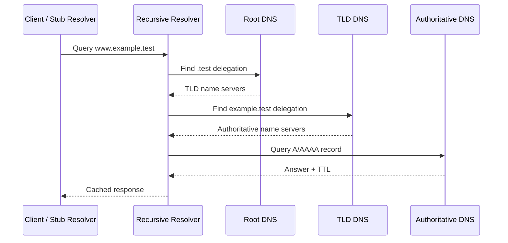

# DNS

> **Networking Master Vault · Transport Protocols and Network Services · NET-06-dns**

[← Category tracker](../buckets/06-protocols-services/README.md) · [← Master dashboard](../README.md)

## 1. Fundamentals and purpose

The Domain Name System (DNS) is a distributed, hierarchical naming system. It maps domain names to records such as A/AAAA addresses, CNAME aliases, MX mail exchangers, TXT data, SRV service records and NS name servers. DNS is a critical dependency for applications, identity, cloud services and service discovery.

DNS commonly uses UDP port 53 for ordinary queries and TCP port 53 for zone transfers and responses requiring TCP; modern DNS transports can also use DoT or DoH. DNS is not simply an IP lookup: caching, delegation, TTLs, split-horizon views and policy all influence the answer.

## 2. Resolution journey

1. Application asks the host resolver for a name.
2. Stub resolver checks local cache and configured recursive resolver.
3. Recursive resolver checks its cache.
4. If needed, it follows referrals from root to TLD to authoritative DNS.
5. Authoritative server returns the record.
6. Recursive resolver caches the response for its TTL and returns it to the client.



## 3. Enterprise architecture example

A company uses internal DNS for private application names and public DNS for customer-facing services. Internal resolvers forward selected zones to cloud private DNS resolvers. Branches use redundant recursive resolvers. Split-horizon DNS returns private addresses to internal clients and public endpoints to external users.

Design controls:
- Redundant resolvers in separate failure domains.
- Restricted recursive access; do not run an open resolver.
- Controlled zone ownership and change approval.
- Appropriate TTLs: short TTLs aid change agility but increase query load.
- DNSSEC validation where supported and required.
- Logging and alerting for query failures, NXDOMAIN spikes and suspicious tunneling patterns.

## 4. Commands and expected outputs

**Linux:**
```bash
dig www.example.com A
dig www.example.com AAAA
dig example.com MX
dig +trace www.example.com
dig @192.0.2.53 app.internal.example A
resolvectl status
getent hosts www.example.com
```

Expected: an A query returns IPv4 records; AAAA returns IPv6 records when published; `+trace` shows delegation steps. A private-zone query must use a resolver that is authorized to answer that zone.

**Cisco IOS / IOS-XE:**
```text
show hosts
show running-config | include ip name-server|ip domain
ping www.example.com
traceroute www.example.com
```

Configure resolver addresses only where the device requires name resolution:
```text
ip name-server 192.0.2.53 192.0.2.54
ip domain lookup
```

## 5. Practical lab: authoritative and recursive resolution

Use a lab DNS server and a client in an isolated environment.

1. Create a test zone such as `lab.example.test`.
2. Add an A record `web.lab.example.test → 192.0.2.20`.
3. Configure the client to use the lab resolver.
4. Query A, AAAA and a nonexistent name.
5. Change the record and observe cache behavior before and after TTL expiry.
6. Break the client's resolver address, then restore it.
7. Capture DNS traffic with Wireshark or tcpdump.

```bash
dig @192.0.2.53 web.lab.example.test A
sudo tcpdump -ni eth0 'port 53'
```

Expected: the correct A record is returned; nonexistent names produce NXDOMAIN; a stale cached answer may persist until its TTL expires or the cache is flushed. Do not use public production domains for destructive zone tests.

## 6. Cloud implementation comparison

| Capability | AWS | Azure | Google Cloud |
|---|---|---|---|
| Managed DNS | Route 53 public/private hosted zones | Azure DNS public/private zones | Cloud DNS public/private zones |
| VPC/VNet name resolution | AmazonProvidedDNS and Route 53 Resolver | Azure-provided DNS and Azure DNS Private Resolver | Cloud DNS policies and forwarding |
| Hybrid integration | Route 53 Resolver inbound/outbound endpoints and rules | Azure DNS Private Resolver | Cloud DNS forwarding/peering zones and inbound forwarding |
| Traffic steering | Routing policies and health checks | Azure Traffic Manager (DNS-based) | Cloud DNS routing policies (feature dependent) / load balancing integrations |

Private DNS associations and forwarding rules must be designed to avoid loops and ambiguous ownership. Verify current regional support, quotas and resolver endpoint requirements.

## 7. Troubleshooting scenarios

- **NXDOMAIN:** confirm spelling, search suffix, authoritative zone and record existence.
- **SERVFAIL:** inspect delegation, DNSSEC validation, unreachable authoritative servers and resolver logs.
- **Wrong/stale IP:** check TTL, caches, split-horizon view and authoritative source.
- **Works by IP, not hostname:** isolate DNS before changing routing or firewall policy.
- **Intermittent name resolution:** inspect resolver redundancy, packet loss, UDP/TCP 53 policy and response truncation.
- **Cloud private name unresolved:** verify private zone association, forwarding rules, resolver endpoint routes and overlapping namespaces.

## 8. Interview and architecture questions

1. Explain recursive vs iterative resolution.
2. What is the role of root, TLD and authoritative DNS?
3. When does DNS use TCP rather than UDP?
4. Explain split-horizon DNS and the risks of forwarding loops.
5. How would you design resilient hybrid DNS across on-premises, AWS, Azure and GCP?

## 9. Knowledge validation

- [ ] Trace a recursive lookup and explain caching/TTL.
- [ ] Inspect A, AAAA, MX, CNAME and NS records.
- [ ] Diagnose NXDOMAIN and SERVFAIL.
- [ ] Demonstrate private-zone resolution from an authorized client.
- [ ] Draw a hybrid DNS forwarding design without loops.

## Further reading

[RFC 1034](https://www.rfc-editor.org/rfc/rfc1034) · [RFC 1035](https://www.rfc-editor.org/rfc/rfc1035) · [AWS Route 53 Resolver](https://docs.aws.amazon.com/Route53/latest/DeveloperGuide/resolver.html) · [Azure DNS](https://learn.microsoft.com/azure/dns/dns-overview) · [Google Cloud DNS](https://cloud.google.com/dns/docs)
