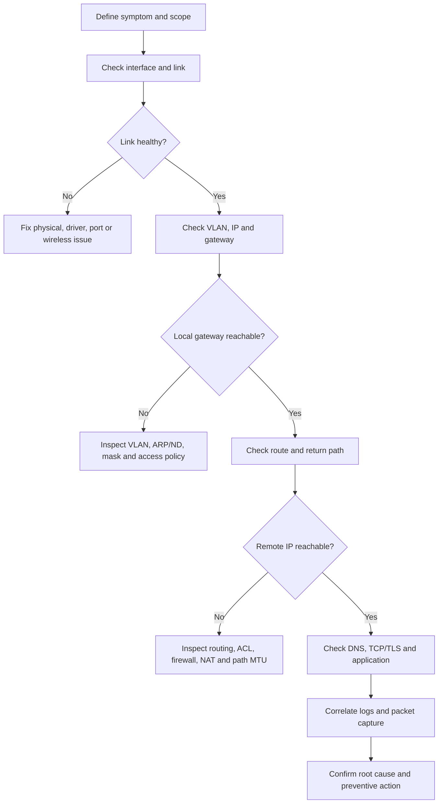

# Network Troubleshooting Methodology

> **Networking Master Vault · Network Operations and Architecture · NET-10-network-troubleshooting**

[← Category tracker](../buckets/10-operations-architecture/README.md) · [← Master dashboard](../README.md)

## 1. Operating principle

Troubleshoot from evidence, not assumptions. Define the user impact, scope, start time, recent changes and expected behavior. Establish a known-good comparison. Form a hypothesis, run the smallest safe test, record the result and update the hypothesis.

Do not make multiple unrelated changes at once. Preserve evidence before clearing counters, restarting services or changing routes.

## 2. Structured method

1. **Scope:** who/what/where is affected? One user, subnet, AZ, region or all users?
2. **Timeline:** when did it start? What changed immediately before it?
3. **Path:** draw the expected forward and return path.
4. **Layer isolation:** physical/link → VLAN/L2 → IP/routing → transport → DNS/TLS → application.
5. **Evidence:** interface counters, routes, ARP/ND, sessions, logs, flow records and packet captures.
6. **Hypothesis:** state the likely cause and a falsifiable test.
7. **Mitigation:** restore service safely, then find root cause.
8. **Prevention:** monitoring, automation, design correction and runbook update.

## 3. Standard diagnostic commands

**Cisco IOS / IOS-XE:**
```text
show clock
show interfaces status
show interfaces counters errors
show vlan brief
show interfaces trunk
show spanning-tree
show mac address-table dynamic
show ip interface brief
show ip route
show ip arp
show ip ospf neighbor
show access-lists
show logging
```

**Linux:**
```bash
ip -br link
ip -br addr
ip route
ip rule
ip neigh
ss -s
ss -tulpn
ping -c 4 192.0.2.1
tracepath 198.51.100.10
dig example.com
curl -vk https://example.com
sudo tcpdump -ni any host 198.51.100.10
```

Command availability varies by distribution; `traceroute`, `tracepath`, `dig` and packet capture tools may need installation and privileges.

## 4. Packet-flow troubleshooting diagram



A ping failure alone is not conclusive: ICMP may be filtered while the application works. Always test the actual protocol and port where appropriate.

## 5. Practical incident scenarios

### Scenario A — DNS works inconsistently
- Compare resolver addresses and responses across affected/unaffected clients.
- Run `dig @resolver name A`, `dig +trace` where appropriate.
- Check TTL, authoritative health, forwarding rules and UDP/TCP 53 reachability.
- Capture DNS packets; look for timeouts, SERVFAIL and retransmissions.

### Scenario B — TCP connection times out
- Check route in both directions.
- Capture SYN, SYN-ACK and ACK at client and server.
- No SYN at server suggests path/policy issue; SYN arrives but no SYN-ACK suggests server listener/host firewall/return route; SYN-ACK leaves server but not client suggests asymmetric path or filtering.

### Scenario C — Large transfers fail, small requests succeed
- Check MTU and Path MTU Discovery.
- Look for ICMP fragmentation-needed / Packet Too Big messages and retransmissions.
- Inspect VPN overhead, tunnel MTU and MSS clamping where relevant.

### Scenario D — Intermittent application outage after firewall change
- Compare rule/policy revision and timestamps.
- Check state table, NAT translation, HA synchronization and asymmetric routing.
- Validate from both sides; roll back only under approved change procedure.

## 6. Practical lab: isolate a broken application path

Topology: Linux client → router/firewall → Linux web server.

1. Verify link, IP, gateway and route.
2. Test gateway reachability.
3. Test server IP with ping, then TCP port with `nc -vz server 443` or `curl`.
4. Test DNS separately using `dig`.
5. Capture traffic at client and server.
6. Inject one fault: wrong route, blocked port, wrong DNS answer or MTU mismatch.
7. Diagnose from packet evidence and restore baseline.

**Expected evidence:** a TCP connection begins with SYN; a working handshake includes SYN-ACK and ACK. DNS failure appears before application connection attempt. A policy drop may show in firewall logs/counters, while a silent drop may require capture on multiple sides to locate.

## 7. Cloud observability comparison

| Need | AWS | Azure | Google Cloud |
|---|---|---|---|
| Flow telemetry | VPC Flow Logs | NSG flow logs / Virtual Network flow logging capabilities | VPC Flow Logs |
| Reachability analysis | VPC Reachability Analyzer | Network Watcher connection troubleshoot / effective routes | Connectivity Tests |
| Route inspection | Route tables, TGW route tables | Effective routes, UDRs | VPC routes |
| Packet evidence | Traffic Mirroring, instance capture | Network Watcher packet capture | Packet Mirroring |
| Metrics/logs | CloudWatch, CloudTrail | Azure Monitor, Activity Log | Cloud Monitoring, Cloud Logging |

Use flow logs to identify conversations and policy outcomes, not as a substitute for full packet captures. Sampling, aggregation and retention vary by service.

## 8. Troubleshooting interview questions

1. A user can ping a server but cannot access HTTPS. Walk through your diagnosis.
2. A site-to-site VPN is up but one subnet cannot reach a cloud workload. What do you check?
3. How do you distinguish routing failure from firewall drop?
4. What does a TCP SYN without SYN-ACK indicate, and what does it not prove?
5. How would you lead a P1 incident across network, security, cloud and application teams?

## 9. Architect-level incident record

Capture:
- Impact and scope
- Start/end times and time zone
- Topology and affected paths
- Recent changes
- Hypothesis and test evidence
- Root cause vs contributing factors
- Mitigation and recovery validation
- Preventive action, owner and due date
- Sanitized logs/captures and links to change/incident records

## 10. Knowledge validation

- [ ] Run a structured Layer 1–7 diagnostic.
- [ ] Interpret a TCP handshake capture.
- [ ] Diagnose DNS, routing, firewall and MTU failures.
- [ ] Compare cloud flow logs and reachability tools.
- [ ] Write an incident summary with evidence and corrective actions.

## Further reading

[Wireshark User Guide](https://www.wireshark.org/docs/) · [tcpdump manual](https://www.tcpdump.org/manpages/tcpdump.1.html) · [AWS Reachability Analyzer](https://docs.aws.amazon.com/vpc/latest/reachability/what-is-reachability-analyzer.html) · [Azure Network Watcher](https://learn.microsoft.com/azure/network-watcher/network-watcher-overview) · [Google Cloud Connectivity Tests](https://cloud.google.com/network-intelligence-center/docs/connectivity-tests/concepts/overview)
