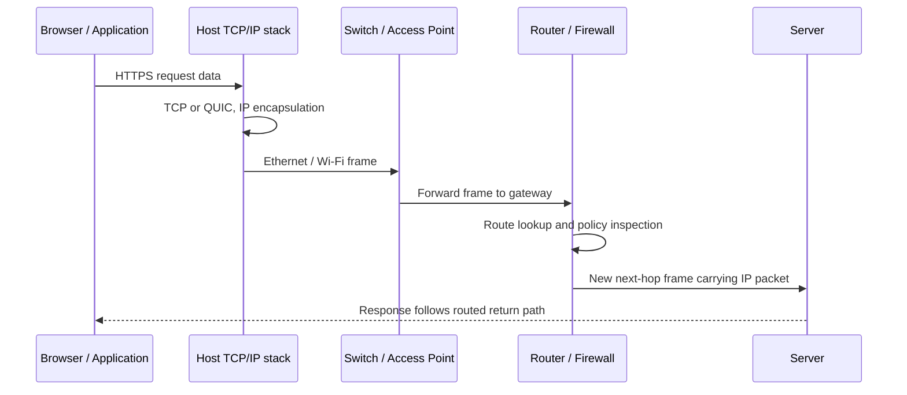

# OSI Model

> **Networking Master Vault · Core Networking Fundamentals · NET-01-osi-model**

[← Category tracker](../buckets/01-core-fundamentals/README.md) · [← Master dashboard](../README.md)

## 1. Fundamentals and purpose

The Open Systems Interconnection (OSI) model is a seven-layer conceptual framework for describing how data moves between applications on different systems. It is a troubleshooting and design vocabulary, not a literal implementation stack required by every product. TCP/IP implementations often combine or blur OSI layers.

| Layer | Name | Main responsibility | Examples |
|---:|---|---|---|
| 7 | Application | Network services used by applications | HTTP, DNS, SMTP |
| 6 | Presentation | Data representation, encoding, encryption formats | TLS functions, UTF-8, JSON |
| 5 | Session | Dialog/session coordination | RPC session concepts |
| 4 | Transport | End-to-end delivery, ports, reliability | TCP, UDP |
| 3 | Network | Logical addressing and routing | IPv4, IPv6, ICMP |
| 2 | Data Link | Local-link framing and MAC delivery | Ethernet, 802.1Q, Wi-Fi MAC |
| 1 | Physical | Signals, media and bit transmission | Copper, fiber, radio |

**Important nuance:** TLS is commonly described around OSI layers 5–6 for teaching, but in real TCP/IP stacks it is implemented as a security protocol between applications and transport. Do not force every technology into one perfect OSI box.

## 2. Real-world example: opening an HTTPS website

1. The browser uses DNS to resolve a hostname to an IP address (application service).
2. The client establishes a TCP connection to destination port 443, unless a different transport such as QUIC is used.
3. TLS negotiates cryptographic parameters and authenticates the server.
4. HTTP request data is carried by the transport connection.
5. IP selects the destination and next hop.
6. Ethernet or Wi-Fi frames carry the packet across the local link.
7. The physical medium transmits bits; routers repeat the Layer 2 framing process for each hop.

At each router, the incoming Layer 2 frame is removed, the IP packet is examined and routed, and a new Layer 2 frame is built for the next link. The source/destination MAC addresses normally change hop by hop; the end-to-end IP addresses normally remain stable except where NAT or other address translation is used.

## 3. Architecture and dependencies

- **Endpoint stack:** NIC, driver, OS network stack, IP configuration and local firewall.
- **Access network:** switch/AP, VLAN, wireless association and port policy.
- **Routing path:** default gateway, route table, next-hop resolution and upstream routing.
- **Security path:** endpoint firewall, network ACL, stateful firewall, proxy, WAF and TLS inspection where deployed.
- **Application path:** DNS, certificate validation, load balancer, application listener and backend dependencies.

## 4. Packet-flow diagram



## 5. CLI and Linux inspection

**Cisco IOS / IOS-XE (device-side evidence):**
```text
show interfaces status
show interfaces gigabitEthernet 1/0/1
show mac address-table dynamic
show vlan brief
show ip interface brief
show ip route
show access-lists
```

**Linux host:**
```bash
ip link show
ip addr show
ip route
ip neigh
ss -tulpn
ping -c 4 192.0.2.1
traceroute 198.51.100.20
sudo tcpdump -ni eth0 'host 198.51.100.20'
```

Expected evidence: interface state is UP, the host has the intended prefix, a default route exists where needed, neighbor resolution is present for the gateway, and traceroute shows the routed path. Exact output varies by OS, topology and policy.

## 6. Practical lab: identify the failing layer

**Topology:** Linux client → access switch → router → Linux web server. Use documentation IP ranges only in an isolated lab.

1. Verify link state and IP configuration.
2. Ping the default gateway.
3. Ping the server IP.
4. Resolve the server name with `dig`.
5. Test TCP port 443 with `curl -vk https://server.example.test`.
6. Capture traffic with `tcpdump` or Wireshark.
7. Introduce one controlled fault at a time: wrong VLAN, missing route, blocked TCP port, incorrect DNS record or invalid test certificate.

**Expected results:** link tests pass before higher-layer tests; IP reachability can succeed while DNS or HTTPS fails. A successful ping does not prove that the application is healthy.

## 7. Cloud implementation mapping

| Concern | AWS | Azure | Google Cloud |
|---|---|---|---|
| Virtual network / L3 | VPC | VNet | VPC network |
| L2 abstraction | Managed fabric; no customer-managed VLAN trunk in ordinary VPC subnet design | Managed fabric; subnet is not a customer-managed Ethernet VLAN | Managed fabric; subnet is a regional IP range |
| Route inspection | VPC route tables, Reachability Analyzer, Flow Logs | Effective routes, Network Watcher, NSG flow logs | Routes, Connectivity Tests, VPC Flow Logs |
| Security controls | Security Groups, Network ACLs, Network Firewall | NSGs, Azure Firewall | VPC firewall rules / firewall policies, Cloud NGFW |

The cloud provider manages much of the physical and Layer 2 infrastructure. Architects work mainly with virtual IP networks, routes, policy and service endpoints.

## 8. Troubleshooting scenarios

- **Can ping IP, cannot open URL:** inspect DNS, proxy, TLS certificate, listener and application health.
- **Can reach local subnet, not remote subnet:** inspect default gateway, route table, ACL/firewall and return route.
- **TCP handshake fails:** verify destination listener, security policy, NAT and asymmetric routing.
- **Intermittent large transfers:** inspect MTU/PMTUD, loss, retransmissions and path changes.

Use evidence from both endpoints and intermediate devices. Do not assume the layer where the symptom appears is the layer where the fault originated.

## 9. Interview and design questions

1. Explain the OSI model using a browser-to-server example.
2. Why do MAC addresses change at each routed hop while IP addresses usually remain the same?
3. Can Layer 3 connectivity work while Layer 7 fails? Give three examples.
4. Where would you inspect a TLS handshake failure?
5. How would you use the OSI model to structure a major-incident troubleshooting bridge?

## 10. Knowledge validation

- [ ] Explain all seven layers without relying only on memorized acronyms.
- [ ] Trace an HTTPS packet from client to server and back.
- [ ] Identify the commands and evidence useful at each layer.
- [ ] Demonstrate one Layer 2, Layer 3, transport and application failure in a lab.
- [ ] Explain why OSI is a troubleshooting model rather than a strict implementation blueprint.

## Further reading

[Sources and official documentation](../SOURCES.md) · [IETF RFC Editor](https://www.rfc-editor.org/) · [Wireshark User Guide](https://www.wireshark.org/docs/)
