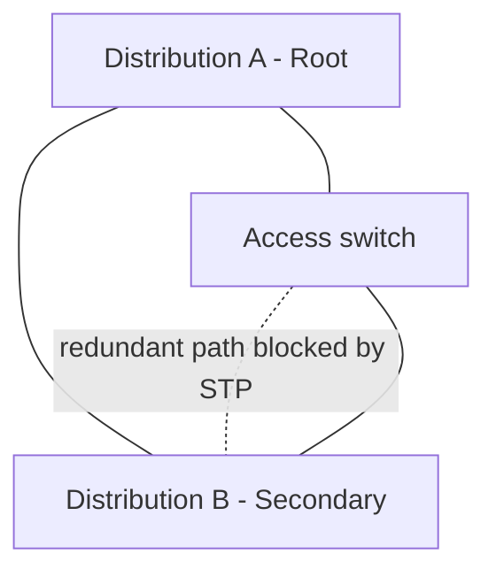

# STP and RSTP

> **Networking Master Vault · Switching and Layer 2 · NET-04-stp-rstp**

[← Category tracker](../buckets/04-switching-layer2/README.md) · [← Master dashboard](../README.md)

## 1. Fundamentals and purpose

Spanning Tree Protocol (STP, IEEE 802.1D) prevents Layer 2 switching loops by creating a loop-free logical topology while retaining redundant physical links. Rapid STP (RSTP, IEEE 802.1w, incorporated into later 802.1 standards) improves convergence through explicit port roles and rapid transition behavior.

A Layer 2 loop can cause broadcast storms, duplicate frames and MAC address-table instability. Redundant links are valuable, but without loop prevention they can create an outage.

## 2. How spanning tree selects paths

1. Switches exchange Bridge Protocol Data Units (BPDUs).
2. The switch with the best Bridge ID becomes the root bridge.
3. Each non-root switch selects its lowest-cost path toward the root as its root port.
4. Each shared segment selects a designated port.
5. Redundant paths that would create a loop are placed into a non-forwarding state.
6. If topology changes, STP recalculates; RSTP can transition faster using proposal/agreement and edge-port behavior.

Bridge ID uses bridge priority plus MAC address; lower is preferred. Path cost is based on link speed and platform/standard cost method.

## 3. Real-world design example

A campus access layer has two distribution switches and redundant uplinks. Set the intended distribution pair as the root and secondary root for the relevant VLANs/instances. This makes forwarding paths predictable and avoids an access switch unexpectedly becoming root.

Consider whether a Layer 3 routed access design would remove the need for spanning tree across distribution uplinks. STP is still relevant at Layer 2 edges and within switched domains.

## 4. Topology diagram



The physical topology remains redundant; spanning tree selects a loop-free active topology for each STP instance/VLAN arrangement.

## 5. Cisco IOS / IOS-XE commands

**Inspect:**
```text
show spanning-tree
show spanning-tree vlan 10
show spanning-tree root
show spanning-tree interface gigabitEthernet 1/0/48 detail
show spanning-tree inconsistentports
show spanning-tree summary
```

**Example root preference (validate platform and change window):**
```text
spanning-tree mode rapid-pvst
spanning-tree vlan 10,20,30 root primary
```

On a secondary switch, set a higher root priority using a platform-supported command such as `spanning-tree vlan 10,20,30 root secondary`.

**Edge-port protection (endpoint ports only):**
```text
interface range gigabitEthernet 1/0/1-24
 spanning-tree portfast
 spanning-tree bpduguard enable
```

PortFast/edge behavior should only be used on ports expected to connect end devices. BPDU Guard err-disables a port if BPDUs arrive, protecting against an accidental or unauthorized switch connection. Do not apply it blindly to switch uplinks.

## 6. Linux bridge inspection

Linux bridge STP support depends on kernel, bridge and network-manager configuration. Inspect bridge state with:
```bash
bridge link
bridge vlan show
bridge -d link show
ip -d link show type bridge
```

On systems managed with `iproute2`, a bridge can be created for a lab; STP enablement and timers are environment-specific. Do not assume a Linux bridge is participating in the same vendor STP mode without verifying the implementation.

## 7. Practical lab: redundant switch links

**Topology:** three switches in a triangle, with one access host on each switch.

1. Connect all three switches in a triangle.
2. Create VLAN 10 on each switch.
3. Enable a consistent STP mode.
4. Set Switch 1 as root and Switch 2 as secondary for VLAN 10.
5. Inspect root bridge, root ports, designated ports and blocked/alternate ports.
6. Shut one active link in the lab and observe reconvergence.
7. Restore the link and check whether the expected topology returns.

**Expected result:** one redundant path is prevented from forwarding in the steady state. After a link failure, a previously alternate path may transition to forwarding. Exact convergence depends on protocol mode, topology, timers and platform.

## 8. Cloud mapping

Public-cloud VPC/VNet networking abstracts the physical Layer 2 fabric. Customers generally do not configure STP or customer VLAN trunks within AWS VPC, Azure VNet or Google Cloud VPC. The relevant cloud design skills are subnetting, route control, segmentation and service connectivity. STP remains important in on-premises switching and certain customer-managed virtualized environments.

## 9. Troubleshooting scenarios

- **Unexpected root bridge:** inspect Bridge IDs, priorities, VLAN/instance scope and newly connected switches.
- **Port stuck blocking/discarding:** determine whether this is expected loop prevention; inspect BPDUs and topology.
- **Frequent topology changes:** inspect flapping access links, edge-port configuration, cabling and BPDU events.
- **BPDU Guard err-disable:** verify whether a switch was connected to an endpoint port; remediate root cause before recovery.
- **Broadcast storm despite STP:** verify STP consistency, VLAN scope, unmanaged switches and possible loops outside the managed domain.

## 10. Interview and design questions

1. Why is STP required when switches have redundant links?
2. How is the root bridge elected?
3. Explain root port vs designated port vs alternate port.
4. What does PortFast do, and why should it not be enabled on switch uplinks?
5. When would you prefer a routed access design over a large Layer 2 domain?

## Knowledge validation

- [ ] Identify root bridge and port roles from command output.
- [ ] Configure a preferred root and secondary root.
- [ ] Demonstrate failover after a link failure.
- [ ] Explain BPDU Guard and edge-port protection.
- [ ] Describe when Layer 3 access is a better architecture.

## Further reading

[IEEE 802.1 working group](https://www.ieee802.org/1/) · [Cisco Spanning Tree documentation](https://www.cisco.com/c/en/us/support/lan-switching/spanning-tree-protocol-stp/series.html)
