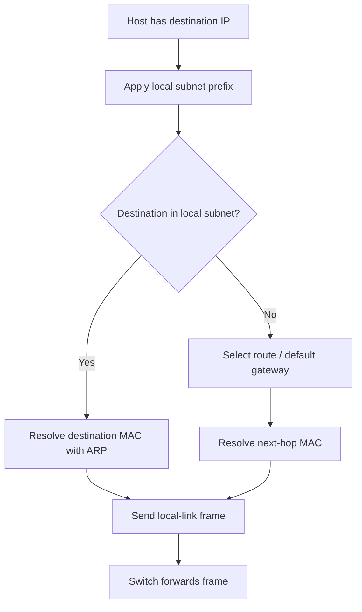

# IPv4 Subnetting

> **Networking Master Vault · IP Addressing and Subnetting · NET-03-subnetting**

[← Category tracker](../buckets/03-ip-addressing/README.md) · [← Master dashboard](../README.md)

## 1. Fundamentals and purpose

Subnetting divides an IPv4 address space into smaller logical networks. A prefix length identifies how many leading bits represent the network. For example, `192.0.2.0/24` has 24 network bits and 8 host bits.

For a conventional IPv4 subnet:
- Total addresses = (2^{32-prefix})
- Conventional usable host addresses = total minus network and broadcast addresses
- The network address has all host bits set to zero.
- The directed broadcast address has all host bits set to one.

The traditional usable-host formula has exceptions: /31 is commonly used for point-to-point links (RFC 3021), and /32 represents a single host route.

## 2. Worked example

Split `10.20.30.0/24` into four equal subnets.

Borrow two host bits: /24 becomes /26. Each /26 contains 64 addresses, conventionally 62 usable hosts.

| Subnet | Network | Usable range | Broadcast |
|---|---|---|---|
| 1 | 10.20.30.0/26 | .1 – .62 | .63 |
| 2 | 10.20.30.64/26 | .65 – .126 | .127 |
| 3 | 10.20.30.128/26 | .129 – .190 | .191 |
| 4 | 10.20.30.192/26 | .193 – .254 | .255 |

**Architect's lesson:** allocate based on expected growth and failure domains, not only today's host count. Reserve blocks for expansion and summarize routes where possible.

## 3. VLSM design example

A site needs 100 user endpoints, 40 voice devices, 20 servers and two point-to-point routed links. A possible allocation from `10.40.0.0/23`:

| Purpose | Prefix | Capacity note |
|---|---:|---|
| Users | /25 | 126 conventional usable |
| Voice | /26 | 62 conventional usable |
| Servers | /27 | 30 conventional usable |
| Point-to-point link A | /31 | 2 addresses, no network/broadcast subtraction |
| Point-to-point link B | /31 | 2 addresses |

Place allocations on correct boundaries and leave unallocated space for growth. This is an example allocation, not a universal sizing rule.

## 4. Packet-flow and routing

A host determines whether a destination is local by applying its subnet mask. If local, it resolves the destination's Layer 2 address. If remote, it resolves the default gateway's MAC address and sends the frame to that gateway.



## 5. Cisco CLI and Linux commands

**Cisco IOS / IOS-XE:**
```text
show ip interface brief
show running-config interface gigabitEthernet 0/0
show ip route
show ip arp
show ip interface gigabitEthernet 0/0
```

Example interface configuration:
```text
interface gigabitEthernet 0/0
 description USERS-LAN
 ip address 10.20.30.1 255.255.255.192
 no shutdown
```

**Linux:**
```bash
ip -4 addr show
ip route
ip route get 10.20.30.70
ipcalc 10.20.30.0/26
ip neigh show
```

Expected route lookup: a destination in the local /26 is marked as directly connected; a destination outside it uses the configured gateway. `ipcalc` may need installation depending on the distribution.

## 6. Practical lab: build two routed subnets

**Topology:** R1 connects two Linux LANs. Use `10.10.1.0/24` and `10.10.2.0/24` in an isolated lab.

1. Configure router interfaces as `10.10.1.1/24` and `10.10.2.1/24`.
2. Assign a host `10.10.1.10/24`, gateway `10.10.1.1`.
3. Assign a second host `10.10.2.10/24`, gateway `10.10.2.1`.
4. Verify each host can ping its gateway.
5. Ping between hosts.
6. Change the second host's prefix to /25 or remove its gateway; observe the failure.
7. Restore the correct configuration.

**Expected result:** both hosts can reach their gateways and each other when the router interfaces and host routes are correct. A wrong prefix can cause a host to ARP for a remote address rather than sending to its gateway.

## 7. Cloud implementation comparison

| Design concept | AWS | Azure | Google Cloud |
|---|---|---|---|
| Address allocation | VPC CIDR and subnet CIDRs | VNet address space and subnet prefixes | VPC subnet primary/secondary ranges |
| Subnet scope | Availability Zone scoped | Regional VNet subnet | Regional subnet |
| Overlap | Avoid overlap for peering/transit | Avoid overlap for peering/VPN/hybrid | Avoid overlap for peering/hybrid connectivity |
| Planning tools | VPC IPAM | Azure Virtual Network Manager / IPAM capabilities as available | VPC network and IP range planning |

Cloud subnet sizing must account for provider-reserved addresses, service-specific minimums and quotas. Do not copy on-prem usable-host arithmetic directly into a cloud subnet without checking provider rules.

## 8. Troubleshooting scenarios

- **Host says destination is local but it is remote:** incorrect subnet mask/prefix.
- **Host reaches gateway but not remote networks:** missing route, firewall or return route.
- **New subnet cannot be created:** overlapping CIDR, provider-reserved range or quota.
- **VPN/peering does not pass traffic:** overlapping address spaces or route propagation/filtering.
- **Intermittent exhaustion:** DHCP scope utilization, static allocations and stale leases.

## 9. Interview and design questions

1. Calculate the network, first/last usable address and broadcast for /27.
2. Design VLSM for user, server and point-to-point segments.
3. Why is /31 useful on routed point-to-point links?
4. What happens if two connected sites use overlapping CIDRs?
5. How would you design an IPAM process for 100 sites and three clouds?

## 10. Knowledge validation

- [ ] Calculate prefixes without relying on a calculator.
- [ ] Explain CIDR, VLSM and route summarization.
- [ ] Build two routed subnets and prove local vs remote forwarding.
- [ ] Identify overlap and provider-reserved address constraints.
- [ ] Produce an IP plan with growth and ownership fields.

## Further reading

[RFC 4632 — CIDR](https://www.rfc-editor.org/rfc/rfc4632) · [RFC 3021 — Using 31-bit Prefixes](https://www.rfc-editor.org/rfc/rfc3021) · [AWS VPC CIDR blocks](https://docs.aws.amazon.com/vpc/latest/userguide/vpc-cidr-blocks.html) · [Azure Virtual Network](https://learn.microsoft.com/azure/virtual-network/virtual-networks-overview) · [Google Cloud VPC](https://cloud.google.com/vpc/docs)
