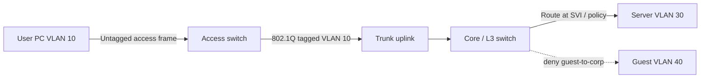

# VLANs

> **Networking Master Vault · Switching and Layer 2 · NET-04-vlans**

[← Category tracker](../buckets/04-switching-layer2/README.md) · [← Master dashboard](../README.md)

## 1. Fundamentals and purpose

A Virtual LAN (VLAN) creates a logical Layer 2 broadcast domain on switching infrastructure. VLANs separate Ethernet broadcast traffic and provide a useful boundary for IP subnet assignment and policy enforcement. A VLAN is not, by itself, a complete security boundary: routing, ACLs, firewalls and identity controls are still required.

Typical enterprise VLANs include user, voice, server, guest, IoT, printer and network-management segments. Avoid a single flat VLAN for an entire enterprise.

## 2. Core components

- **VLAN ID:** 12-bit 802.1Q identifier; usable IDs are generally 1–4094, with reserved/special cases depending on platform.
- **Access port:** carries traffic for one configured VLAN; endpoint frames are typically untagged.
- **Trunk port:** carries multiple VLANs using 802.1Q tags.
- **Native VLAN:** untagged VLAN on an 802.1Q trunk; configure consistently and avoid using it for sensitive endpoint traffic.
- **SVI:** switch virtual interface that can provide a Layer 3 gateway for a VLAN on a multilayer switch.
- **Inter-VLAN routing:** routes traffic between VLANs and enables policy enforcement at the Layer 3 boundary.

## 3. Real-world example

A 3-floor office has:
- VLAN 10 — Corporate users, `10.10.10.0/24`
- VLAN 20 — Voice, `10.10.20.0/24`
- VLAN 30 — Servers, `10.10.30.0/24`
- VLAN 40 — Guest, `10.10.40.0/24`
- VLAN 99 — Network management, `10.10.99.0/24`

Guest clients should reach the internet but not corporate or server subnets. Users may reach approved application ports on servers. Network management should be accessible only from privileged admin endpoints.

## 4. Packet-flow diagram



A same-VLAN frame is switched within its Layer 2 domain. A frame destined for another subnet is sent to the default gateway; the Layer 3 device routes it and creates a new Layer 2 frame in the destination VLAN.

## 5. Cisco IOS / IOS-XE configuration

Example for an isolated lab:
```text
vlan 10
 name USERS
vlan 30
 name SERVERS
!
interface gigabitEthernet 1/0/10
 description USER-ACCESS
 switchport mode access
 switchport access vlan 10
 spanning-tree portfast
!
interface gigabitEthernet 1/0/48
 description UPLINK-TRUNK
 switchport mode trunk
 switchport trunk allowed vlan 10,30
!
interface vlan 10
 ip address 10.10.10.1 255.255.255.0
 no shutdown
interface vlan 30
 ip address 10.10.30.1 255.255.255.0
 no shutdown
ip routing
```

Platform syntax varies. Some switches require an explicit trunk encapsulation command; newer models support only 802.1Q. Apply PortFast only to endpoint-facing ports, never indiscriminately to switch-to-switch links.

**Verification:**
```text
show vlan brief
show interfaces trunk
show interfaces switchport
show mac address-table dynamic
show ip interface brief
show ip route
```

Expected: VLANs 10 and 30 are active, access ports belong to intended VLANs, trunks carry only required VLANs, SVIs are up when the VLAN has an active Layer 2 member, and connected routes appear when Layer 3 is enabled.

## 6. Linux VLAN inspection

```bash
ip -d link show
bridge vlan show
ip -br addr
sudo tcpdump -eni eth0 vlan
```

Example Linux VLAN interface (requires appropriate privileges and an existing parent interface):
```bash
sudo ip link add link eth0 name eth0.10 type vlan id 10
sudo ip addr add 10.10.10.10/24 dev eth0.10
sudo ip link set eth0 up
sudo ip link set eth0.10 up
```

Expected: `ip -d link` identifies VLAN ID 10 on parent `eth0`. The upstream switch port must be configured to carry the matching VLAN.

## 7. Practical lab: segmentation and validation

**Topology:** two access switches or one managed switch, a router/L3 switch and three hosts.

1. Create VLANs 10, 30 and 40.
2. Place host A in VLAN 10, host B in VLAN 30 and guest host C in VLAN 40.
3. Configure trunks between switches and the Layer 3 gateway.
4. Configure SVIs or router-on-a-stick gateways.
5. Verify same-VLAN reachability and inter-VLAN routing.
6. Apply an ACL/firewall policy that denies guest-to-private traffic.
7. Capture tagged frames on the trunk and untagged frames on an access link.

**Expected results:** hosts in the same VLAN communicate at Layer 2; hosts in different subnets use a gateway; guest policy blocks private networks while the intended internet egress remains available.

## 8. Cloud comparison

| Concept | AWS | Azure | Google Cloud |
|---|---|---|---|
| VLAN equivalent | Subnet + route/security policy abstractions; no customer-managed VLAN IDs in standard VPC | VNet subnet + NSG/route policy; no customer-managed VLAN trunk | VPC subnet + firewall policy; no customer-managed VLAN trunk |
| Segmentation | Separate subnets, Security Groups, NACLs, routing | Subnets, NSGs, Azure Firewall, route tables | Subnets, firewall rules/policies, routes |
| Hybrid VLAN extension | Typically routed VPN/private connectivity; L2 extension is not the normal VPC model | Typically routed VPN/ExpressRoute; use specific supported hybrid designs | Typically routed VPN/Interconnect |

Do not assume an on-premises VLAN can be stretched directly into a public-cloud subnet. Design Layer 3 connectivity and policy boundaries.

## 9. Troubleshooting scenarios

- **VLAN missing on far switch:** inspect trunk allowed list and VLAN database consistency.
- **Host cannot reach gateway:** verify access VLAN, SVI state, subnet and ARP.
- **One direction works:** inspect return route, ACL and asymmetric policy.
- **Trunk works for some VLANs only:** check allowed VLAN list, native VLAN mismatch and pruning.
- **VLAN hopping or exposure risk:** harden unused ports, disable auto-trunk negotiation where appropriate, use explicit access/trunk mode and control native VLAN.

## 10. Interview and design questions

1. Why does a VLAN not provide complete security isolation?
2. Explain access vs trunk ports and 802.1Q tagging.
3. What causes an SVI to remain down/down?
4. How would you design VLANs for users, voice, servers, guest and management?
5. Why is routed access often preferred over very large Layer 2 domains?

## Knowledge validation

- [ ] Create VLANs and assign access ports.
- [ ] Configure and verify an 802.1Q trunk.
- [ ] Explain tagged vs untagged traffic.
- [ ] Enable and validate inter-VLAN routing.
- [ ] Demonstrate guest isolation with a policy and verify using packet captures.

## Further reading

[IEEE 802.1Q](https://www.ieee802.org/1/pages/802.1Q.html) · [Cisco VLAN configuration guidance](https://www.cisco.com/c/en/us/support/docs/lan-switching/vlans/10023-3.html) · [AWS VPC](https://docs.aws.amazon.com/vpc/latest/userguide/what-is-amazon-vpc.html)
